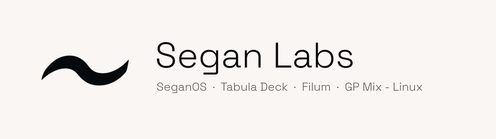

<picture>
  <source media="(prefers-color-scheme: dark)" srcset="assets/banner-dark.png">
  
</picture>

Software by [Bagas Fajar Wicaksono](https://segan.me), made in Indonesia. Downloads are at **[get.segan.me](https://get.segan.me)**.

<table>
  <tr>
    <td width="96" align="center" valign="top">
      
    </td>
    <td valign="top">
      <b><a href="https://get.segan.me/tabula">Tabula Deck</a></b> 
      Your phone is the deck. Keys and faders on your phone control OBS, MIDI, system and app volume, sounds and shortcuts on your PC. Nothing to install on the phone: scan a QR code and press a key. 
      Windows · macOS · Linux
    </td>
  </tr>
  <tr>
    <td width="96" align="center" valign="top">
      
    </td>
    <td valign="top">
      <b><a href="https://get.segan.me/filum/">Filum</a></b> 
      Your TikTok stream key, straight into OBS. 
      Windows · macOS · Linux
    </td>
  </tr>
  <tr>
    <td width="96" align="center" valign="top">
      
    </td>
    <td valign="top">
      <b><a href="https://get.segan.me/mixer">GP Mix - Linux</a></b> 
      A virtual audio mixer for Linux: the Linux edition of GP Mix. 
      Linux
    </td>
  </tr>
  <tr>
    <td width="96" align="center" valign="top">
      <a href="https://get.segan.me/seganos"><b>OS</b></a>
    </td>
    <td valign="top">
      <b><a href="https://get.segan.me/seganos">SeganOS</a></b> 
      Linux, finally designed. A desktop and its own apps, free.
    </td>
  </tr>
</table>

### Contact

[chat@segan.me](mailto:chat@segan.me) · [segan.me](https://segan.me)
